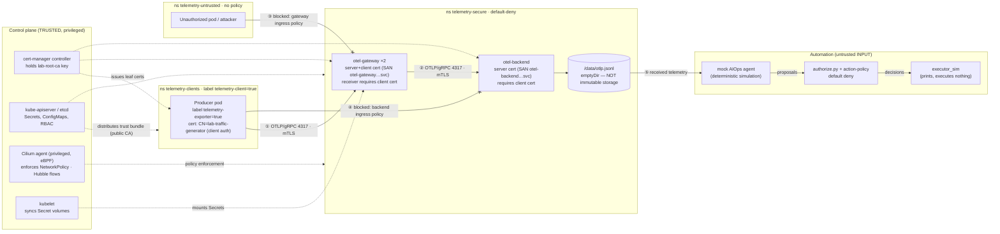

# Worked threat model — the local mTLS lab

A populated instance of [TEMPLATE.md](TEMPLATE.md) for the architecture that **actually exists in
`lab/`**. It separates what the lab implements and tests from what is only conceptual. Status words follow
[docs/claims-and-evidence.md](../docs/claims-and-evidence.md); nothing here is marked verified unless a test
case executed. This is a lab model, not a review of any production system.

## 1. Scope and architecture

In scope: one synthetic producer → OpenTelemetry Collector gateway (×2) → OTLP backend, on a disposable
kind cluster with Cilium NetworkPolicy enforcement, cert-manager PKI, and a simulated AIOps consumer.
Out of scope: Prometheus federation, Loki/Grafana, Falco, tail sampling, storage immutability (none of these
are deployed — see [§7](#7-conceptual-threats-not-implemented-in-the-lab)).

Edges ①②: peer authentication + transport protection (mTLS). ③④: network authorization (NetworkPolicy).
⑤ onward: nothing authenticates *truthfulness* of content; the only guard is authorizing the *action*.

## 2. Assets

| ID | Asset | Why it matters |
|---|---|---|
| A1 | Integrity of telemetry at the backend | AIOps/humans decide from it |
| A2 | Gateway/backend/client private keys, and the CA key | Possession = identity |
| A3 | Trust bundle (`telemetry-trust-bundle`) | Whoever alters it changes who is trusted |
| A4 | Availability of the ingestion path | Gap = blind spot during incidents |
| A5 | The cluster's mutating authority (what automation could be made to do) | Blast radius of a poisoned decision |
| A6 | Evidence of what happened (backend file, Hubble flows, test results) | Forensics; here **not tamper-resistant** |

## 3. Attacker capabilities (lab model)

| ID | Capability | Modelled in lab? |
|---|---|---|
| C1 | Network-adjacent pod without credentials in an unapproved namespace | Yes — `telemetry-untrusted` |
| C2 | Holder of a certificate from an untrusted CA (spoofing the issuer name) | Yes — rogue CA |
| C3 | Holder of a **valid** client cert/key used from an unapproved place (stolen credential) | Yes — N6 |
| C4 | **Compromised approved producer** (valid cert, approved network position) emitting arbitrary content | Yes (content only) — Phase 3 scenario |
| C5 | Rogue/impersonated backend (attacker controls what a client connects to) | Partly — exporter trust checks (E2/E3), not a full DNS/route hijack |
| C6 | Can read Secrets in lab namespaces / cluster-admin / CA-key holder | **No — trusted by assumption** (§5) |
| C7 | Author of log text (anyone whose input ends up in a log line) | Yes — instruction-shaped log text |

## 4. Trust boundaries and identities

| Boundary | Crossing | Authenticated by | Authorized by |
|---|---|---|---|
| TB1 untrusted/other namespaces → telemetry-secure | any TCP | — | NetworkPolicy (namespace + pod labels) |
| TB2 producer → gateway | OTLP/gRPC 4317 | client cert chained to `telemetry-ca`; gateway cert verified by client (CA + SAN) | NetworkPolicy; **no identity-level (SAN/CN) authorization** |
| TB3 gateway → backend | OTLP/gRPC 4317 | same pattern | NetworkPolicy (backend admits only `app=otel-gateway`) |
| TB4 backend → automation | file read via `kubectl exec` | cluster credentials | RBAC of the operator (outside lab scope) |
| TB5 automation → cluster actions | proposal → decision | — | `action-policy.yaml` default deny |

| Identity | Issued to | Key usage | Issuer | Verified where |
|---|---|---|---|---|
| `lab-root-ca` | trust anchor | CA | self-signed | everywhere via trust bundle |
| `otel-gateway` | gateway pods | server + client | `telemetry-ca` | by producers (server auth) and backend (client auth) |
| `otel-backend` | backend pod | server | `telemetry-ca` | by gateway exporter |
| `lab-traffic-generator` | producer pods | client | `telemetry-ca` | by gateway |

**Single-CA caveat:** every certificate chains to one CA, so *any* `telemetry-ca` client certificate satisfies
both the gateway and the backend. Separation between the producer and the backend is therefore enforced by
NetworkPolicy alone (N4), not by cryptographic identity. See residual risk R2.

## 5. Privileged components and trusted assumptions

The model **assumes these are not compromised**; a compromise defeats most controls below.

* **cert-manager controller** — holds the CA private key in a Secret; can mint any identity.
* **kube-apiserver / etcd** — Secrets are stored without envelope encryption in the lab; cluster-admin can read
  every key and edit every ConfigMap, Deployment and NetworkPolicy.
* **Cilium agent** — privileged, loads eBPF; its NetworkPolicy enforcement and Hubble output are trusted.
  Hubble DROPPED/FORWARDED records are observations, not proof of TLS authentication or kernel isolation, and
  the eBPF verifier does not prove that the *policy* is correct.
* **kubelet / container runtime / Docker Desktop VM** — mount Secrets and enforce Pod Security.
* **Whoever runs `distribute-trust.sh`** — decides the trust root.
* **The test runner** — uses cluster-admin credentials from `lab/.kube/config`.

## 6. Implemented lab scenarios → controls → validation

Execution status and evidence for each test case are in [claims-and-evidence.md](../docs/claims-and-evidence.md)
(a case listed here is only a *candidate* validation until it appears there as executed). The "Control"
column says which of the six properties is being exercised: **PA** peer authentication · **TP** transport
protection · **AZ** authorization · **SI** storage integrity · **TT** telemetry truthfulness · **AA**
authorization of actions derived from telemetry.

| ID | Scenario | Prerequisite | Control (property) | Test case | Residual risk |
|---|---|---|---|---|---|
| L1 | Sender presents no client cert | C1 with network access | Receiver `client_ca_file` (PA) | R2 | none beyond R2-class below |
| L2 | Sender presents cert from untrusted CA with spoofed issuer name | C2 | Chain verification (PA) | R3 | CA key compromise (R1) |
| L3 | Client talks to a gateway whose cert isn't from its CA / wrong name | C5 | Server cert verify, CA + SAN (PA, TP) | R4, R5 | Only as good as the trust bundle (R1) |
| L4 | Gateway exporter talks to a backend with untrusted CA / wrong name | C5 | Exporter verify (PA, TP) | E2, E3 | Probe mirrors, not edits, gateway config (R7) |
| L5 | Exporter without / with untrusted client cert | C2, C1 | Backend `client_ca_file` (PA) | E4, E5 | Same CA for all hops (R2) |
| L6 | Unauthorized pod reaches gateway | C1 | Gateway ingress NetworkPolicy (AZ) | N2, N3 (+Hubble N2h, N3h) | Label/namespace governance (R3) |
| L7 | Producer bypasses gateway to backend | C4 | Backend ingress NetworkPolicy (AZ) | N4 (+N4h) | Single CA (R2) |
| L8 | Valid cert used from the wrong network location | C3 | NetworkPolicy independent of mTLS (AZ) | N6 | Stolen key from an *approved* pod works (R4) |
| L9 | Approved pod tries arbitrary egress | C4 | Source egress allow-list (AZ) | N5 | |
| L10 | Gateway leaf cert/key rotated | operational | cert-manager + Collector reload (TP) | ROT1–ROT4 | Mixed old/new window; exporter reload unobserved (R5, R6) |
| L11 | Authenticated producer emits instruction-shaped text; automation proposes a destructive action | C4, C7 | Action authorization, default deny (AA) | S1–S7 | Content still reaches storage and humans (R4) |

## 7. Conceptual threats not implemented in the lab

From TEMPLATE.md §3. **No lab component and no test exists for these.** Do not read the lab results as
coverage of them.

| ID | Threat | What would be needed to implement | Related claim in the talk |
|---|---|---|---|
| T1 | Tail-sampling manipulation | A tail-sampling Collector, controlled altered input, retained-trace assertions | Authenticated ingestion ≠ trustworthy sampling input |
| T2 | Federation / exporter pivot | Two Prometheus instances, `/federate`, scrape-target allow-lists (Phase 5A, **not done**) | Cert auth for federation |
| T3 | Credential-bearing log queries | Loki + enforcement layer + two tenants (Phase 5B, **not done**) | Least-privilege queries |
| T4 | Collector configuration tampering | RBAC/admission policy tests, Falco/audit rules (**none deployed**) | Config-tamper detection |
| T5 | Storage tampering | Hash-chain + protected checkpoint, or WORM storage (Phase 5C, **not done**) | Append-only storage / tamper evidence |

## 8. Residual risks and limitations (explicit)

| ID | Risk | Notes |
|---|---|---|
| R1 | CA key / cert-manager / API server compromise defeats peer authentication | Trusted by assumption (§5); lab stores the CA key in a Secret |
| R2 | One CA for every hop; no SAN/identity authorization | Any issued client cert is accepted by gateway **and** backend; only NetworkPolicy separates roles |
| R3 | NetworkPolicy is label-based; anyone who can set pod/namespace labels can join the allow-list | Governed by RBAC/admission, not tested |
| R4 | **A compromised approved producer can emit any content, and it is stored** | mTLS/NetworkPolicy do not address truthfulness (TT). S-cases show only that the *action* is gated |
| R5 | During rotation the two gateway replicas can serve different certs for a measurable window | Across five runs the switch to the new certificate took roughly 55–125 s after reissuance, and the replicas sometimes differed by about a minute; clients must trust the CA, not a pinned leaf |
| R6 | Rotation was exercised once per scenario on one CA pair: leaf re-issue (ROT1–4) and CA B with trust overlap plus exporter pickup (CAR0–5). No revocation, intermediates, or client-certificate rotation | single runs only |
| R7 | Exporter tests use a probe Collector that mirrors the gateway's TLS options | Live gateway config is checked only indirectly (D1 works) |
| R8 | Backend storage is an `emptyDir`; evidence is not tamper-resistant or retained | Storage integrity (SI) is **not implemented** |
| R9 | Hubble/Cilium are trusted observers; flow retention is a small ring buffer, per node | Absence of a flow proves little |
| R10 | The AIOps consumer is a simulation | Says nothing about real model behaviour or detection of poisoned content |
| R11 | Only macOS/Docker Desktop was exercised | |

## 9. Six properties — what the lab does and does not give you

| Property | In the lab | Evidence |
|---|---|---|
| 1. Peer authentication | mTLS both hops; untrusted/absent certs rejected | R2–R5, E2–E5 |
| 2. Transport protection | TLS version observed by an openssl witness against the backend | E6 |
| 3. Authorization | Network-level only (NetworkPolicy); no identity-based authorization | N1–N6 |
| 4. Storage integrity | **Not implemented** (emptyDir file) | — |
| 5. Telemetry truthfulness | **Not addressed**; poisoned content passes | S1 |
| 6. Authorization of actions derived from telemetry | Demonstrated in a simulation with a separate default-deny policy | S3–S7 |
